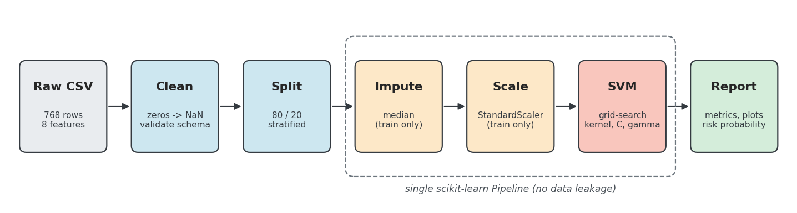
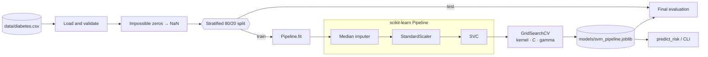
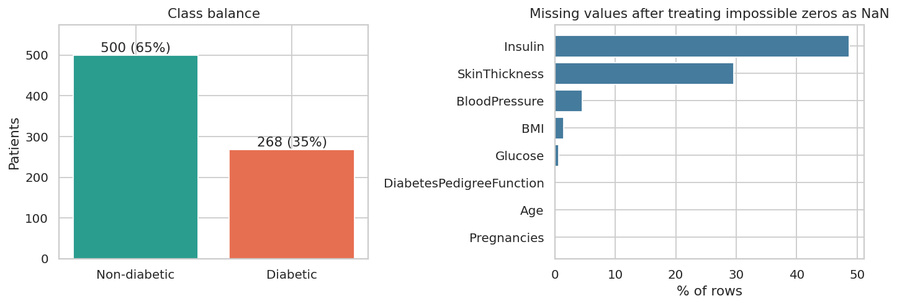
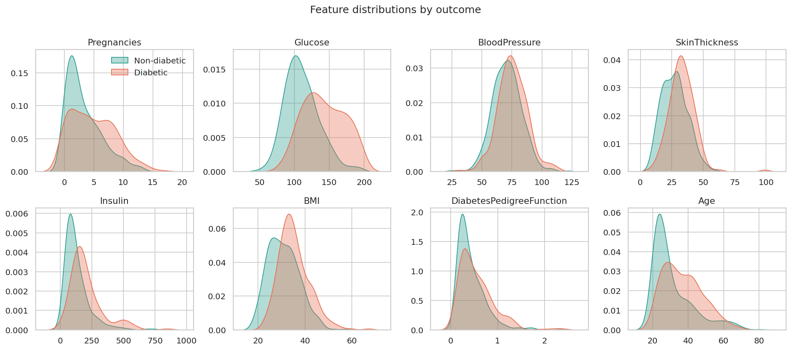
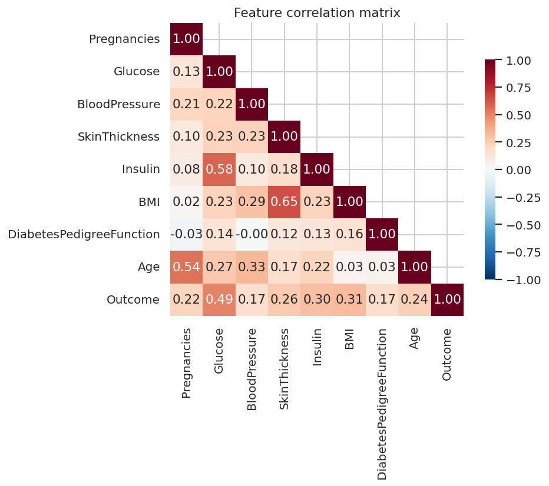
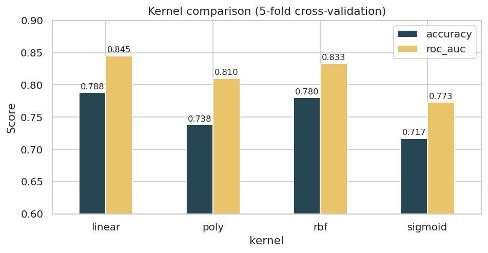
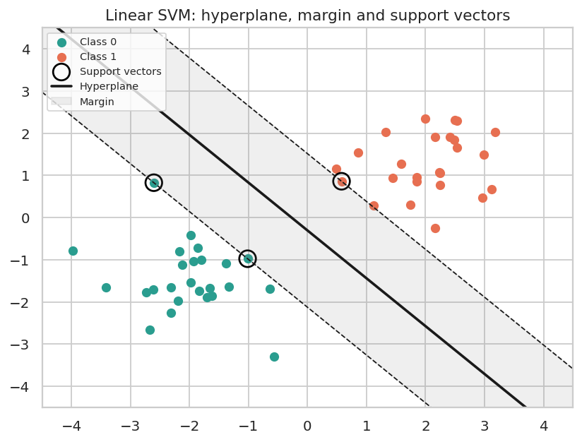
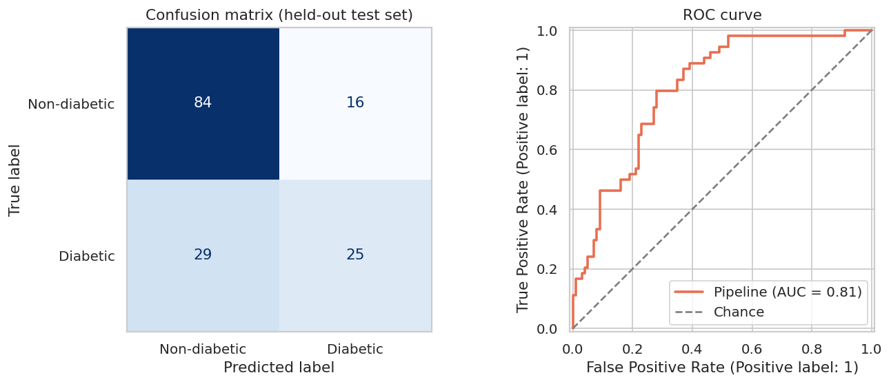
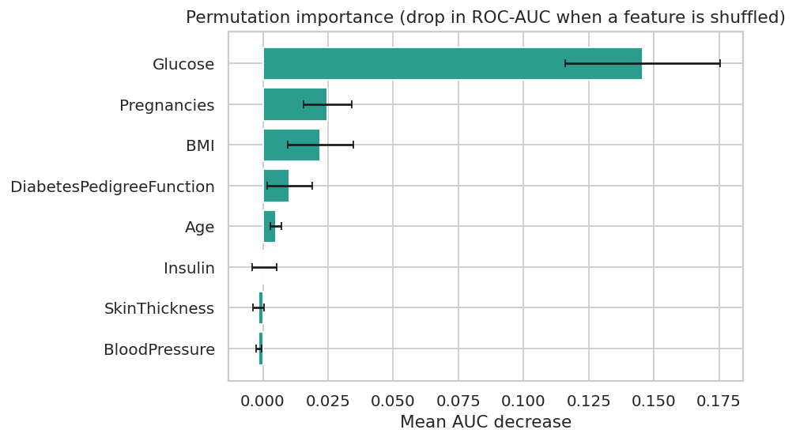
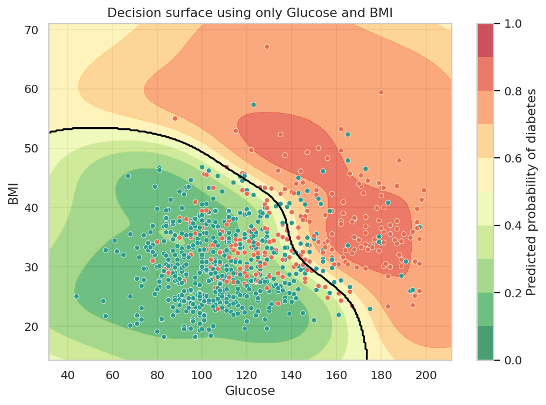

<div align="center">

# Diabetes Risk Classifier

**A leak-free, reproducible Support Vector Machine pipeline for screening diabetes risk from routine clinical measurements.**


-6f42c1)



</div>

---

## At a glance

| | |
|---|---|
| **Task** | Binary classification: diabetic vs non-diabetic |
| **Data** | 768 patients, 8 numeric clinical features ([details](docs/dataset.md)) |
| **Model** | Imputer → StandardScaler → SVM, tuned by grid search |
| **Selected model** | RBF kernel, `C=1`, `gamma=0.01` |
| **Cross-validated ROC-AUC** | **0.846 ± 0.011** (5-fold, training split) |
| **Held-out test ROC-AUC** | **0.805** (154 patients) |
| **Interfaces** | Python API, command-line scripts, walkthrough notebook |

## How it works



Three design decisions shape the project:

- **Zeros are missing data.** A glucose, blood pressure, skin-thickness, insulin or BMI of `0` is physiologically impossible, so those entries become `NaN` and are imputed with the training median
- **Everything lives in one `Pipeline`.** Imputation medians and scaling statistics are learned from training folds only, so the test set never influences preprocessing.
- **Several metrics, not just accuracy.** With roughly 35 % positives, accuracy alone hides how many true cases are missed, so precision, recall, specificity, F1 and ROC-AUC are all reported

## Quick start

```bash
# 1. Get the code and create an environment
git clone <your-repository-url> diabetes-risk-svm
cd diabetes-risk-svm
python -m venv .venv && source .venv/bin/activate      # Windows: .venv\Scripts\activate
pip install -r requirements.txt

# 2. Train, evaluate, save the model and regenerate every figure
python scripts/train.py

# 3. Score a person (omit any option to treat it as unmeasured)
python scripts/predict.py --glucose 166 --bmi 25.8 --age 51 --pregnancies 5 \
    --blood-pressure 72 --skin-thickness 19 --insulin 175 --pedigree 0.587

# 4. Run the tests or open the walkthrough
python -m unittest discover -s tests
jupyter notebook notebooks/diabetes_svm_walkthrough.ipynb
```

Using it from Python:

```python
from diabetes_svm import predict_risk

print(predict_risk({"Glucose": 166, "BMI": 25.8, "Age": 51}))
# Positive screening result (estimated probability 54%, moderate risk band)
```

## Data exploration

**Class balance and missing values**



**Feature distributions by outcome**: glucose shows the clearest separation between the two groups.



**Correlations**



## Modelling

Each kernel was wrapped in the identical pipeline and compared with 5-fold stratified cross-validation on the training split:

| Kernel | Accuracy | ROC-AUC |
|---|---|---|
| linear | 0.788 | 0.845 |
| rbf | 0.780 | 0.833 |
| poly | 0.738 | 0.810 |
| sigmoid | 0.717 | 0.773 |



Linear and RBF are nearly tied on defaults. A grid search over `C` and `gamma` (optimising ROC-AUC) then selected the RBF kernel with `C=1`, `gamma=0.01`

For intuition about what an SVM is doing, this schematic shows the separating hyperplane, the margin and the support vectors on toy data:

<div align="center">



</div>

## Results

**Held-out test set (154 patients, never used for fitting or tuning)**

| Metric | Value |
|---|---|
| Accuracy | 0.708 |
| Precision | 0.610 |
| Recall (sensitivity) | 0.463 |
| Specificity | 0.840 |
| F1 | 0.526 |
| ROC-AUC | 0.805 |

**5-fold cross-validation on the training split (mean ± std)**

| Metric | Value |
|---|---|
| Accuracy | 0.777 ± 0.019 |
| Precision | 0.760 ± 0.061 |
| Recall | 0.533 ± 0.019 |
| F1 | 0.625 ± 0.023 |
| ROC-AUC | 0.846 ± 0.011 |



> **Reading these numbers honestly.** The test set is small, so a single split moves accuracy by several points; the cross-validated figures are the steadier estimate. Because preprocessing is fitted on training data only, the numbers are lower than tutorials that scale the full dataset before splitting, but they are the ones you can expect on genuinely new patients. The model is conservative: it rarely flags healthy people but misses roughly half of true cases at the default 0.5 threshold. For a screening use case you would lower the threshold to favour recall

## Interpreting the model

**Permutation importance**: how much ROC-AUC drops when each feature is shuffled



**Decision surface** on two features (Glucose and BMI) only, to visualise the non-linear boundary. The black line is the 50 % probability contour



## Project layout

```text
diabetes-risk-svm/
├── data/diabetes.csv                  # dataset
├── src/diabetes_svm/                  # importable package
│   ├── config.py                      # paths, columns, seeds
│   ├── data.py                        # loading, validation, zero→NaN
│   ├── pipeline.py                    # Pipeline + grid search
│   ├── evaluate.py                    # metrics, CV, kernel comparison
│   ├── plots.py                       # all figures and diagrams
│   └── predict.py                     # risk report for one person
├── scripts/
│   ├── train.py                       # end-to-end training + figures
│   └── predict.py                     # command-line scoring
├── notebooks/diabetes_svm_walkthrough.ipynb
├── tests/test_pipeline.py             # unit tests (unittest)
├── models/                            # saved pipeline + metrics.json
├── assets/                            # generated figures and diagrams
└── docs/
    ├── dataset.md                     # feature-by-feature data notes
    └── svm-algorithm.md               # SVM theory and tuning guide
```

## Further reading

- [Dataset notes](docs/dataset.md): feature definitions, quality issues, ethical considerations
- [SVM algorithm guide](docs/svm-algorithm.md): maths, kernels, tuning and metrics
